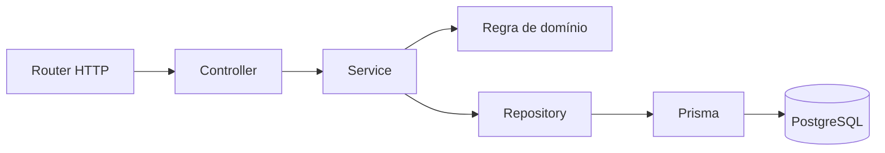

# Arquitetura do backend

O backend é um **monólito modular em TypeScript**: uma API Express e um banco PostgreSQL, com o código organizado por funcionalidade. TypeScript usa modo estrito e módulos ESM. Prisma 7 gera o cliente tipado a partir do schema; o adaptador `@prisma/adapter-pg` realiza a conexão com PostgreSQL 18.

Os módulos de autenticação, repúblicas, financeiro, tarefas, dashboard e MASTER estão conectados à API. `GET /api/health` preserva a resposta `{ "status": "ok" }`; `GET /api/openapi.json` publica os contratos. A migração e as regras de exclusão da conta estão descritas em [MIGRACAO_DJANGO.md](MIGRACAO_DJANGO.md).

## Organização

```text
codigo/
  app.ts                         # Composição do Express, sem iniciar servidor
  server.ts                      # Inicialização e encerramento do processo
  configuracao/env.ts             # Leitura e validação do ambiente
  compartilhado/http/             # Erros HTTP e respostas comuns
  infraestrutura/
    banco/                       # Cliente Prisma e transações ACID
    armazenamento/               # Comprovantes privados
  comandos/                      # Provisionamento, seed e exportação de contrato
  contratos/                     # OpenAPI, schemas e exemplos de integração
  modulos/
    saude/                       # Endpoint de saúde
    autenticacao/                # Autenticação e identidade
    republicas/                  # Repúblicas e vínculos de moradores
    financeiro/                  # Despesas, rateios e pagamentos
      dominio/                   # Cálculo do rateio em centavos
    tarefas/                     # Tarefas e responsáveis
    painel/                      # Consultas e indicadores
    administracao/               # Administração global
  gerado/prisma/                 # Código gerado; não editar manualmente
testes/                          # Testes unitários, HTTP e de banco
  auxiliares/                    # Fixtures e utilitários dos testes
documentacao/                    # Arquitetura, banco e migração
prisma/
  migracoes/                     # Histórico SQL versionado
interface/
  codigo/
    recursos/                    # Imagens e demais recursos da interface
  publico/                       # Arquivos públicos do Vite
integracao/                      # Tipos OpenAPI e exemplos para navegador
```

As pastas do projeto usam português sem acentos. `node_modules`, `dist`, `.git` e os diretórios internos gerados pelo Prisma conservam os nomes das ferramentas; `http` e `prisma` mantêm os nomes do protocolo e da tecnologia. O nome público dos endpoints não depende das pastas.

| Componente | Responsabilidade |
| --- | --- |
| [app.ts](../codigo/app.ts) | Criar a aplicação, registrar rotas e instalar os handlers de 404 e erro. Importar a aplicação não abre uma porta nem cria uma conexão com o banco. |
| [server.ts](../codigo/server.ts) | Validar a configuração, conectar ao banco antes de abrir a porta e fechar HTTP e banco ao receber SIGINT ou SIGTERM. |
| [configuracao/env.ts](../codigo/configuracao/env.ts) | Carregar `.env` e validar banco, JWT e configuração HTTP sem imprimir credenciais. |
| `*.routes.ts` | Associar caminhos e métodos HTTP aos controllers. |
| `*.controller.ts` | Adaptar requisição e resposta HTTP, incluindo a validação da entrada. |
| `*.service.ts` | Coordenar o caso de uso, as regras de negócio e suas transações. |
| `*.repository.ts` | Concentrar consultas e gravações no Prisma, usando a transação recebida pelo serviço quando necessário. |
| `dominio/` | Manter regras puras, como o cálculo do rateio, independentes de Express e Prisma. |
| [client.ts](../codigo/infraestrutura/banco/client.ts) e [transaction.ts](../codigo/infraestrutura/banco/transaction.ts) | Criar o cliente e executar transações com isolamento, commit síncrono e retry limitado. |

Nem toda funcionalidade precisa de todos os arquivos. `saude` tem rota e controller porque sua resposta é estática; não precisa de serviço nem repositório.

O [handler de erros](../codigo/compartilhado/http/error-handler.ts) padroniza respostas como `{ "error": { "code": "...", "message": "..." } }`. Erros de validação do Zod e JSON inválido retornam 400; conflitos de unicidade do Prisma retornam 409; registros ausentes retornam 404. Falhas inesperadas retornam uma mensagem genérica, sem detalhes internos.

## Dependências

Para novos endpoints de negócio, adote este fluxo:



Controllers não concentram consultas SQL. Repositórios não leem `Request` ou `Response`. Serviços recebem os dados necessários ao caso de uso e preservam a transação entre as gravações relacionadas.

O [serviço financeiro](../codigo/modulos/financeiro/financeiro.service.ts) coordena os casos de uso HTTP e conserva os helpers internos utilizados pelos testes. O [repositório](../codigo/modulos/financeiro/financeiro.repository.ts) concentra as consultas; a regra [dividirIgualmente](../codigo/modulos/financeiro/dominio/rateio.ts) é pura. Identidade e permissões são conferidas dentro da transação por `withActor`, evitando decisões baseadas em tokens com perfis antigos. As garantias do banco estão em [BANCO_DE_DADOS.md](BANCO_DE_DADOS.md).

## Desenvolvimento e execução

Depois de configurar o `.env` local e preparar o banco:

```powershell
npm ci
npm run auth:secret
npm run db:generate
npm run db:deploy
npm run typecheck
npm test
npm run dev
```

O desenvolvimento usa `tsx`; a verificação de tipos é feita separadamente com `typecheck`. Para executar o JavaScript compilado:

```powershell
npm run build
npm start
```

O build usa `tsc` e a execução usa `node dist/server.js`. Os imports relativos usam `.js` também nos fontes TypeScript para que o resultado seja resolvido pelo Node em ESM; `NodeNext` faz a correspondência com os arquivos `.ts` durante a compilação. [Resolução de módulos no TypeScript](https://www.typescriptlang.org/docs/handbook/modules/reference.html)

`db:generate` cria `codigo/gerado/prisma`; esse diretório e `dist` não são versionados. O gerador `prisma-client` usa saída TypeScript e módulo ESM, acompanhando a configuração do projeto. [Gerador do Prisma 7](https://www.prisma.io/docs/orm/v7/prisma-schema/overview/generators)

`npm test` verifica as regras puras e o comportamento HTTP, sem depender de PostgreSQL. `npm run test:db` executa os testes de integração com a `TEST_DATABASE_URL` explícita; veja o preparo e os cuidados com fixtures em [BANCO_DE_DADOS.md](BANCO_DE_DADOS.md).

`npm run verificar` reúne build, exportação do contrato, tipos e testes, exigindo o banco dedicado para evitar integração ignorada. `npm run db:seed` cria a demonstração de forma atômica e repetível, sem sobrescrever alterações. CORS é configurado por origens explícitas no ambiente. O [guia de integração](INTEGRACAO_BACKEND.md) descreve a entrega para o frontend.

## Adicionar funcionalidades

1. Defina os dados de entrada e valide o que chega por HTTP. Tipos TypeScript não substituem validação em execução.
2. Implemente o caso de uso no serviço e as consultas no repositório do módulo. Operações relacionadas devem compartilhar a mesma transação ACID.
3. Acrescente testes das regras e do comportamento observável. Use o banco de teste dedicado nos casos que precisam de persistência.
4. Registre a rota na aplicação quando sua autenticação e autorização estiverem implementadas.

O cadastro público rejeita campos de privilégio. JWT usa assinatura HS256 com segredo local e duração de uma hora; logout, bloqueio e exclusão invalidam tokens por versão. MASTER é provisionado exclusivamente pelo comando administrativo documentado. Comentários no código explicam invariantes, limites de autorização e decisões transacionais, em vez de repetir operações óbvias.

Na configuração compilada, migrations são um serviço separado e a API inicia de `dist`, sem ferramentas de build no startup. A API usa um pool dedicado e limitado para readiness e middleware de logs JSON com UUID por requisição, sem registrar entradas privadas. `APP_TIME_ZONE` adota o horário de Brasília como padrão dos relatórios e datas civis. O [guia operacional](OPERACAO_BACKEND.md) detalha volumes, recuperação e CI.

Na versão 2.0.1, comprovantes usam bytea em tabela própria, com FK para pagamentos. A preparação e o hash antecedem a transação, que grava ambos; as consultas públicas não carregam o conteúdo. O download autoriza antes da consulta binária. Arquivos locais são usados apenas pelo importador legado.
