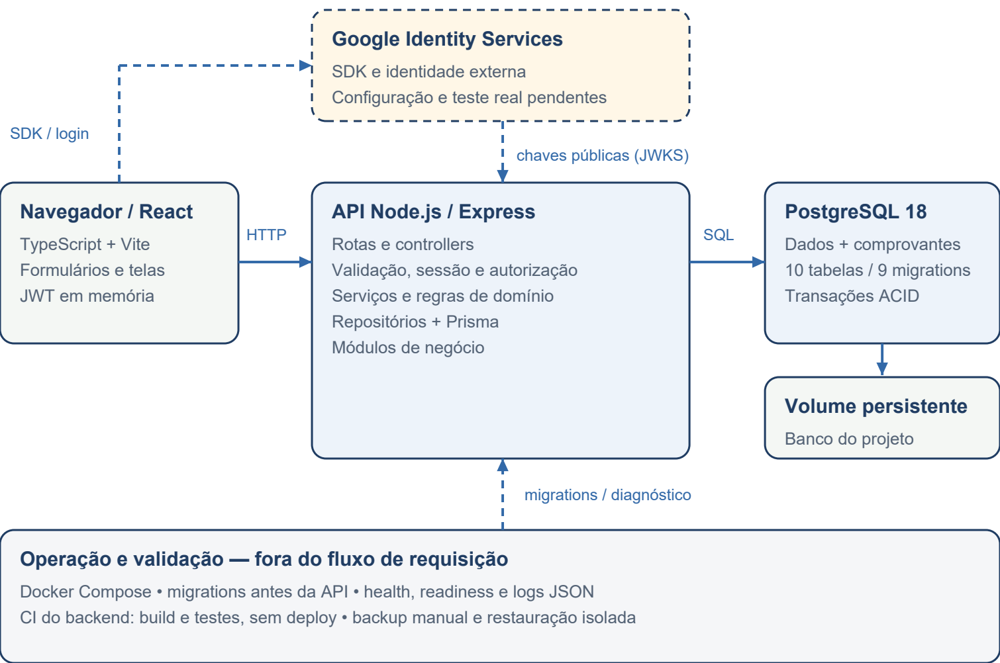

# RepHouse

FÁBRICA DE SOFTWARE • DOCUMENTAÇÃO TÉCNICA

Arquitetura, infraestrutura e operação

Consolidação da solução • referência de 5 de novembro de 2026

## Equipe

Mateus De Miranda Santos Moura • Erick Alves • Gabriel Santana • João Victor Florêncio • Patrick José • Miqueias Barros

| Referência | Situação conferida |
| --- | --- |
| Aplicação e contrato | Versão 2.1.0; 41 caminhos e 51 operações HTTP no OpenAPI. |
| Código consultado | Branch chore/homologacao-ci, base 47f8a35, com alterações locais ainda sem commit. |
| Validação local | 128 testes do backend e 20 testes de navegador aprovados, sem testes ignorados. |
| Entrega atual | Execução local em Docker. Sem nova publicação, push ou CI remota nesta etapa. |

## 1. Arquitetura da solução

O RepHouse organiza moradores, tarefas e despesas de repúblicas e outras casas compartilhadas. A solução tem uma interface React em TypeScript, uma API Node.js com Express e um banco PostgreSQL. O backend é um monólito modular: seus módulos são separados por responsabilidade, mas executados no mesmo processo e publicados como uma única aplicação.

A organização em camadas separa rotas e controllers HTTP, serviços de aplicação, regras de domínio e acesso aos dados pelo Prisma. O frontend faz a apresentação; o backend decide permissões e coordena cada operação; o banco garante vínculos e consistência. Essa divisão aproveita a ideia de MVC, com serviços e repositórios explícitos para evitar regras de negócio nos controllers.

Uma API e um banco reduzem o trabalho de operação e permitem manter transações entre pagamentos, rateios e comprovantes. Não há justificativa medida para dividir o MVP em microsserviços. Hospedagem pública, alta disponibilidade e mudanças na infraestrutura são propostas de evolução, não entregas já implantadas.

---

# Diagrama arquitetural

ESTRUTURA DA SOLUÇÃO

Figura 1 — Arquitetura atual e componentes de operação. Linhas contínuas representam o fluxo principal. A integração Google está implementada, mas depende de configuração e validação real. CI e backup não participam de cada requisição.

## 2. Componentes e responsabilidades

| Componente | Responsabilidade |
| --- | --- |
| Interface React | Login e cadastro, perfil, repúblicas, moradores e tarefas. Cliente fetch com tipos do OpenAPI; JWT somente em memória. |
| Rotas e controllers | Receber HTTP, validar entradas e adaptar respostas. Helmet, CORS, identificação de requisições e limites protegem a entrada. |
| Serviços e domínio | Executar casos de uso, conferir sessão e autorização dentro da transação e calcular rateios sem perder centavos. |
| Repositórios / Prisma | Consultar e persistir os dados com cliente tipado e a mesma transação do caso de uso. O serviço Google também usa diretamente o cliente transacional. |
| PostgreSQL 18 | Guardar dados e comprovantes; aplicar constraints, índices, triggers e transações ACID. |
| Ferramentas de operação | Aplicar migrations, provisionar MASTER, conferir comprovantes, gerar backups e testar restauração em ambiente isolado. |

---

# 3. APIs da aplicação

CONTRATO E COMUNICAÇÃO

O contrato OpenAPI 3.1 descreve as operações da versão 2.1.0 e gera os tipos TypeScript compartilhados com o frontend. A API usa JSON sobre HTTP; operações privadas recebem Authorization: Bearer. Morador, administrador da república e MASTER têm permissões distintas, sempre verificadas pelo backend.

| Grupo | Exemplos de operações |
| --- | --- |
| Autenticação e conta | POST /api/auth/register, /api/auth/login e /api/auth/logout; GET, PATCH e DELETE /api/me. |
| Repúblicas e moradores | POST /api/republicas; entrada, troca, saída e transferência sob /api/republicas; GET /api/membros. |
| Tarefas | GET e POST /api/tarefas; PATCH /api/tarefas/{id} para alterações permitidas e conclusão. |
| Financeiro | GET/POST /api/despesas; POST /api/pagamentos; GET /api/me/financeiro e /api/pagamentos/{id}/comprovante. |
| Administração MASTER | Consultas globais em /api/master/usuarios e /api/master/republicas, bloqueios e operações com escopo explícito de república. |
| Operação | GET /api/health, /api/ready e /api/openapi.json. |

Listagens usam {dados,paginacao}, com página inicial 1, limite padrão 20 e máximo 100. usuarioId identifica a conta; membroId identifica seu vínculo com uma república. Datas civis entram como YYYY-MM-DD. Respostas 204 não têm corpo. Erros usam {error:{code,message}} e X-Request-Id: 400 para entradas inválidas, 401 para autenticação, 403 para permissão, 404 para ausência, 409 para conflito, 413 para excesso de corpo, 429 para limite e 503 para indisponibilidade. Falhas inesperadas retornam 500 sem detalhes internos.

## 4. Integrações e estado atual

O frontend acessa /api pelo proxy Vite no desenvolvimento. Os tipos gerados e os exemplos fetch seguem o contrato; login, perfil, repúblicas, moradores e tarefas já têm jornadas reais de navegador com PostgreSQL de testes. As telas financeiras, a exclusão de conta pela interface e a área global MASTER ainda não foram entregues.

Google Identity Services está implementado com botão oficial e validação de assinatura, audiência, emissor, validade, e-mail verificado e nonce. A identidade usa o sub do Google; vincular um e-mail local existente exige sua senha. Falta configurar o Client ID e testar uma conta real. Não há integração Pix ou provedor de cobrança: pagamentos atuais são registros internos, sem liquidação bancária automática.

---

# 5. Banco de dados

PERSISTÊNCIA E INTEGRIDADE

O PostgreSQL 18 concentra os dados relacionais e os comprovantes. O schema atual contém dez tabelas e nove migrations. O banco rabbu_mvp é separado do banco legado banco_projeto; migrations aplicadas são preservadas e qualquer evolução usa um arquivo adicional, sem reset do ambiente da equipe.

| Conjunto | Tabelas e vínculos |
| --- | --- |
| Identidade e acesso | usuarios, identidades_google e desafios_google. E-mail e sub únicos; uma identidade Google por conta; desafio temporário e de uso único. |
| Organização da casa | republicas e membros_republica. Um vínculo ativo por usuário; administrador ativo vinculado à própria república. |
| Financeiro | despesas, rateios_despesa e pagamentos. Uma despesa reúne parcelas por membro; cada parcela admite pagamentos parciais com chave de idempotência. |
| Arquivos e tarefas | comprovantes tem no máximo um registro por pagamento. tarefas associa a atividade à república e ao membro responsável. |

## Como as transações ACID são aplicadas

| Propriedade | Aplicação no RepHouse |
| --- | --- |
| Atomicidade | Pagamento e comprovante são gravados juntos; falha antes do commit reverte ambos. Criação de conta Google, identidade e consumo do desafio também são atômicos. |
| Consistência | FKs, unicidade, checks e triggers impedem vínculos inválidos, sobrepagamento e alteração do histórico financeiro. Uma validação diferida impede contas sem senha e sem identidade Google. |
| Isolamento | Transações SERIALIZABLE e revalidação de sessão/permissão dentro da operação. Conflitos transitórios têm repetição limitada; não se reduz o isolamento para aumentar vazão. |
| Durabilidade | Commit síncrono e fsync, synchronous_commit e full_page_writes ativados nos ambientes Docker definidos. Volumes persistem o banco; backup é uma proteção adicional. |

Comprovantes usam bytea, entre 1 byte e 5 MiB, com MIME, tamanho e SHA-256 conferidos. PDF, PNG, JPEG e WEBP são os tipos aceitos. O download exige autorização e os bytes não entram nas listagens JSON. Pagamentos e comprovantes são imutáveis; saída da república e exclusão lógica preservam o histórico. Valores monetários usam decimal com duas casas; relatórios seguem o horário de Brasília.

---

# 6. Infraestrutura e operação

EXECUÇÃO E CONTINUIDADE

O ambiente de desenvolvimento usa Docker Compose com React/Vite em 5173, API em 3000 e PostgreSQL com volume persistente. Nesse Compose, a porta 5432 do banco é publicada para desenvolvimento. Ela não é publicada na configuração separada do backend compilado. Testes usam banco, projeto e schemas exclusivos, sem seed ou limpeza no banco da equipe.

A imagem compilada usa Node.js 24, instalação pelo lockfile e etapas separadas de build e execução. A API roda como usuário node, sem root e sem montagem do código do computador. Um serviço separado aplica migrations antes da API. A homologação documentada usa projeto próprio e API na porta 3403; não equivale a um endereço público já hospedado.

Health confirma o processo; readiness consulta o PostgreSQL e responde 503 quando indisponível, dentro de dois segundos. Logs JSON registram requestId, método, padrão da rota, status e duração, sem corpos, senhas ou tokens. O servidor limita headers a 10 segundos e requisições a 30; ao encerrar, drena as requisições por até 15 segundos.

O backup manual usa pg_dump customizado e manifesto de formato 2 com versão e hashes; os comprovantes vão no próprio banco. Há trava por projeto, parada temporária e reinício da API mesmo após erro. A restauração ocorre somente em instância e volumes novos, com validação do manifesto; o formato legado 1 continua aceito. É necessário conferir o banco efetivamente usado pela API antes de capturar: variáveis de inicialização do container não alteram um volume antigo. Não há agendamento, cópia externa automática, recuperação contínua por WAL ou tempo de recuperação garantido.

## 7. Estratégia de deploy — proposta

A CI existente valida o backend em Linux com Node 24 e PostgreSQL 18 temporário: npm ci, migrations, regressão, contrato/tipos e ensaio Docker de recuperação. Pushes e PRs para main e homologacao disparam o workflow; carga exige acionamento manual. A execução remota registrada é da versão 2.0.1 em 17/10/2026. A versão 2.1.0 e o frontend têm as validações locais descritas neste documento, sem nova CI remota.

Para a primeira publicação, propõe-se servir o build React e /api pela mesma origem HTTPS, com proxy reverso, API compilada e PostgreSQL em rede privada. Antes de liberar: aprovar o provedor, configurar segredos, CORS e Google, separar credenciais de aplicação e migrations, testar o backup e validar homologação. Publicar uma versão identificada, aplicar migrations compatíveis, conferir readiness e executar uma jornada curta. Reverter a imagem apenas se ela aceitar o schema atual; restauração do banco exige procedimento próprio. Não há deploy automático, balanceador ou alta disponibilidade implantados.

---

# 8. Escalabilidade

CAPACIDADE E SUSTENTAÇÃO

A referência de crescimento é 1.000 contas, 100 repúblicas, 10.000 despesas e 2.000 tarefas, com 50 usuários simultâneos por cinco minutos. O ensaio histórico limitou a API a 2 CPUs/1 GiB e o PostgreSQL a 2 CPUs/2 GiB. Os resultados abaixo pertencem a execuções locais anteriores; não são uma nova medição da versão 2.1.0.

| Medição | Sem arquivos no banco | Com arquivos no banco |
| --- | --- | --- |
| Referência / resultado | 17/10/2026; aprovado | 17/10/2026; meta geral não atingida |
| p95 leitura / escrita | 177,5 / 219,5 ms | 127,6 / 194,2 ms |
| Vazão | 39,25 req/s | 39,47 req/s |
| Respostas 429 / erros 500 | Nenhuma falha inesperada / 0 | 145 / 0 |
| Integridade e isolamento | Sem inconsistências medidas | Sem inconsistências medidas |

Na carga com comprovantes de aproximadamente 256 KiB, latências e taxa de falhas abaixo de 1% passaram, mas 145 respostas 429 impediram a aprovação geral. O banco cresceu cerca de 320 MB. A limitação de dois uploads simultâneos é por instância e foi mantida; não foi elevada para esconder saturação. Os cenários não comprovam que anexos melhoram o desempenho nem garantem capacidade em outro servidor.

A evolução deve começar medindo SQL, índices, espera por transações, conexões, memória e armazenamento. Primeiro ajustar consultas e capacidade de forma controlada; depois avaliar réplicas da API. O estado persistente já fica no banco, mas os limitadores HTTP e de uploads são locais a cada instância e exigem revisão antes de escalar horizontalmente. Não há cache compartilhado, fila, réplica de banco ou autoscaling implantados.

## 9. Custos técnicos

| Item | O que considerar no orçamento |
| --- | --- |
| Execução local | Usa o computador e Docker da equipe; considerar memória, disco, energia e tempo de configuração. Não foi contratada hospedagem nesta entrega. |
| Hospedagem futura | Orçar CPU/RAM da API e do PostgreSQL, serviço estático/proxy, domínio e tráfego. O provedor e o valor mensal ainda não foram definidos. |
| Dados e recuperação | Comprovantes aumentam banco, WAL, tráfego e duração do backup. Orçar armazenamento, cópia externa protegida e retenção antes da publicação. |
| Manutenção | Reservar trabalho para dependências, CI, migrations, testes de recuperação, diagnóstico e correção de falhas. Isso continua existindo mesmo em serviços gratuitos. |

Sem provedor, região, retenção e volume de uso aprovados, um preço mensal seria uma suposição. A cotação deverá separar despesas recorrentes de implantação e manutenção. Os limites do ensaio servem como ponto de comparação, não como um plano de hospedagem já dimensionado.

---

# 10. Riscos técnicos

LIMITES E PRÓXIMAS DECISÕES

| Risco / prioridade | Controle atual e ação necessária |
| --- | --- |
| Acesso entre repúblicas — alta | Autorização transacional e regressão de isolamento. Repetir essas jornadas ao adicionar telas ou mudar privilégios; CORS não substitui autorização. |
| Perda de dados — alta | Volumes e backup manual com restauração isolada já exercitada em versões anteriores. Definir frequência, cópia externa, retenção e objetivos de perda/recuperação antes de hospedar. |
| Saturação de uploads — alta | 145 respostas 429 no ensaio com anexos. Manter proteção, medir a demanda e dimensionar capacidade sem reduzir integridade ou aumentar limites sem evidência. |
| Falha no servidor único — alta | Readiness, logs e reinício auxiliam o diagnóstico, mas não fornecem alta disponibilidade. Definir recuperação e disponibilidade esperadas para produção. |
| Google ainda não validado — média | Assinaturas controladas e fluxo de interface testados. Configurar Client ID e contas de teste; executar login, vinculação, cancelamento e bloqueio reais antes de anunciar disponibilidade. |
| Diferença entre validações — média | Separar resultados locais 2.1.0 da CI remota 2.0.1. Submeter a versão atual à CI e incluir verificação de frontend quando uma publicação for autorizada. |
| Segredos e dependências — alta | .env fora do Git, lockfiles e container sem root. Na hospedagem, definir gestão/rotação de segredos, revisar privilégios e fixar imagens por versão ou digest aprovado. |

As próximas decisões são configurar e validar o Google real, revisar o resultado com o grupo, escolher a infraestrutura e fechar o orçamento operacional. A publicação depende de nova autorização. Pix, telas financeiras e administração MASTER no frontend continuam em etapas próprias.

## Fontes conferidas no projeto

- **Arquitetura e código** — codigo/app.ts, codigo/server.ts, módulos e cliente de banco; interface/codigo; manifests e lockfiles.
- **Contrato e persistência** — documentacao/openapi.json; integracao/api.d.ts; prisma/schema.prisma e nove migrations.
- **Infraestrutura e operação** — Dockerfile; arquivos Compose; workflow de backend do GitHub Actions; documentacao/OPERACAO_BACKEND.md.
- **Validação atual local** — documentacao/evidencias/validacao-login-google.json e validacao-login-painel-foto.json: 128 testes de backend e 20 de navegador.
- **Histórico de carga e CI** — validacao-comprovantes.json, carga-consolidacao.json e validacao-homologacao.json, de 17/10/2026. A execução remota não foi refeita para este relatório.
- **Documentação anterior** — Entrega de Fábrica de Software de 27/10/2026, usada como referência de apresentação. Propostas antigas de divisão de equipe não foram tratadas como atribuições confirmadas.

Este documento descreve o checkout local consultado, incluindo alterações ainda não publicadas. Não afirma conclusão da integração Google real, de hospedagem, de novas medições de carga ou de CI para a versão atual.

