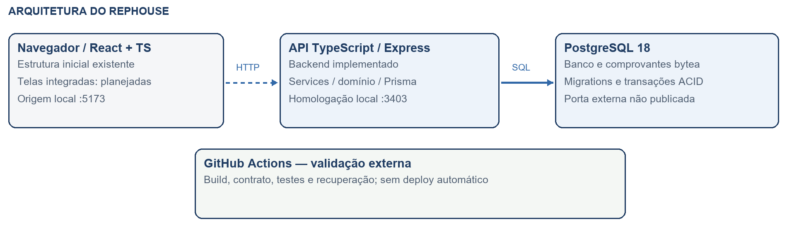
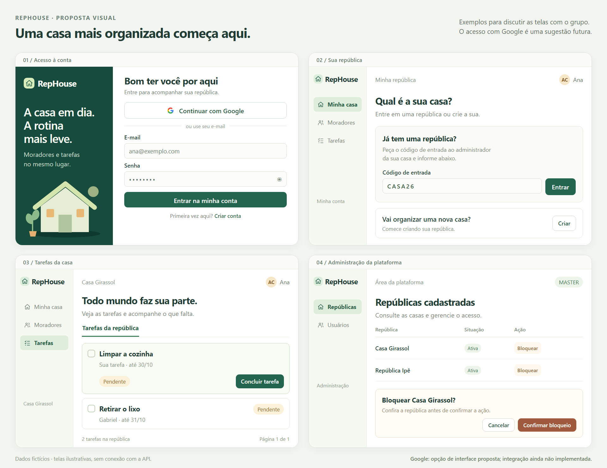

# RepHouse

DOCUMENTAÇÃO DO PROJETO • FÁBRICA DE SOFTWARE

Organização do projeto, planejamento e viabilidade

## Equipe

Mateus De Miranda Santos Moura • Erick Alves • Gabriel Santana • João Victor Florêncio • Patrick José • Miqueias Barros

| Referência | Registro |
| --- | --- |
| Disciplina e docente | Fábrica de Software — professor Luis Fernando Pereira Santos. |
| Data de referência | 27 de outubro de 2026. Documento v1.0; aplicação e contrato HTTP v2.0.1. |
| Versão de referência | Commit 47f8a35, na branch chore/homologacao-ci; PR #1 para homologacao. |
| Objetivo da próxima etapa | Organizar a integração das telas com as funções já disponíveis no backend. |
| Data acadêmica de entrega | A confirmar. O planejamento considera três semanas após a aprovação do grupo. |

## Situação do projeto

O backend do RepHouse já reúne cadastro, login, gestão de repúblicas, moradores, despesas e tarefas. A execução de 17/10/2026 registrou 112 testes aprovados. Na consulta ao repositório em 27/10, o PR de homologação estava aberto, com a CI aprovada e a revisão por outro integrante ainda pendente. O frontend disponível no repositório tinha apenas a página inicial. Essas informações constam no relatório de validação do backend e no PR de homologação.

## Sobre este planejamento

A divisão de responsabilidades, o cronograma e a rotina de trabalho apresentados aqui são uma proposta para o grupo discutir. Os resultados técnicos vêm dos registros do repositório. As estimativas financeiras são uma simulação, e os testes com usuários ainda serão realizados.

O documento segue os oito tópicos do guia da disciplina. O checklist anexo indica onde cada requisito foi tratado. Os documentos anteriores de ideia e orçamento continuam como referência para a evolução do projeto.

<!-- QUEBRA DE PÁGINA -->

# 1. Contexto e organização


O RepHouse é um sistema para organizar repúblicas estudantis e outras moradias compartilhadas. A ideia é reunir em um só lugar os moradores da casa, as tarefas e as despesas. O projeto parte da dificuldade de acompanhar essas informações quando elas ficam espalhadas em conversas, planilhas e anotações. Essa necessidade ainda precisa ser discutida com moradores, pois não há entrevistas registradas. A apresentação inicial do projeto está nas referências ao final.

O sistema atende moradores e administradores das repúblicas. Há também o perfil MASTER, responsável pela administração da plataforma. Cada pessoa deve conseguir consultar suas responsabilidades, enquanto o administrador acompanha a organização da casa e o histórico dos registros.

## Divisão de responsabilidades sugerida

| Integrante | Responsabilidade | Entrega e revisão |
| --- | --- | --- |
| Mateus De Miranda Santos Moura | Backend, banco e integração técnica. | Manter a API e o banco; Miqueias revisa o ambiente e Patrick testa os fluxos. |
| Erick Alves | Telas de login, conta e perfil. | Integrar acesso e perfil à API; Gabriel revisa e Patrick testa. |
| Gabriel Santana | Telas de repúblicas, moradores e tarefas. | Integrar os fluxos da casa; Erick revisa e Patrick testa. |
| João Victor Florêncio | Organização das tarefas, requisitos e documentação. | Manter o planejamento e discutir as entregas com o grupo e o docente. |
| Patrick José | Testes e avaliação com usuários. | Preparar os testes, registrar resultados e encaminhar falhas aos responsáveis. |
| Miqueias Barros | Ambiente de execução, CI e recuperação. | Apoiar a execução do projeto; Mateus revisa e Patrick confere o funcionamento. |

A proposta combina desenvolvimento, revisão e testes entre os seis integrantes. Na reunião inicial, o grupo deve ajustar as funções de acordo com a disponibilidade de cada um e definir quem pode ajudar em caso de atraso.

## Como o trabalho será organizado

Cada tarefa deve ter um responsável e um resultado esperado. Para integrar a tela de tarefas, por exemplo, o resultado é permitir que o morador veja suas tarefas e conclua a que está sob sua responsabilidade. O fluxo sugerido é:

- Registrar o que precisa ser feito, relacionar ao requisito e combinar como a entrega será conferida.
- Definir a prioridade e a semana de execução. O responsável desenvolve em uma branch separada no Git.
- Testar a alteração e abrir um pedido de integração (PR) para homologacao. Outro integrante revisa o código, e a CI executa os testes automaticamente.
- Depois da aprovação e da integração em homologacao, demonstrar o funcionamento para a equipe e registrar os ajustes necessários.
- Com a jornada validada, propor a integração em main, branch destinada à versão estável.

O repositório já usa branches, PR e testes automáticos. A revisão por outro integrante e o quadro de tarefas fazem parte da rotina proposta para esta etapa.

O código usa TypeScript e separa rotas, regras de negócio e acesso ao banco. Novas alterações no banco devem ser feitas por migrations. O OpenAPI descreve as requisições e respostas da API; os tipos gerados e os exemplos de uso ajudam o frontend a seguir esse contrato. As funções de validação, autorização e paginação são compartilhadas entre os módulos.

Para começar a contribuir, o integrante deve ler a arquitetura, preparar o ambiente pelo guia de homologação e executar uma jornada com contas fictícias. Isso permite entender o projeto antes de alterar o código.

<!-- QUEBRA DE PÁGINA -->

# 2. Escopo e requisitos funcionais


A próxima etapa é integrar login, perfil, repúblicas, moradores, tarefas e administração MASTER. O módulo financeiro já existe e permanece nos testes de regressão. A integração com Pix e novas mudanças em pagamentos ficam para depois. As telas dessas jornadas ainda precisam ser desenvolvidas.

| Requisito | Como conferir o funcionamento | Situação |
| --- | --- | --- |
| RF-MVP-01 | Cadastrar conta NORMAL; rejeitar privilégio enviado no cadastro. | Disponível no backend; tela pendente. |
| RF-MVP-02 | Login válido permite /me; logout ou token expirado resulta em 401. | Disponível no backend; tela pendente. |
| RF-MVP-03 | Criar república e vínculo do responsável na mesma operação. | Disponível no backend. |
| RF-MVP-04 | Entrar por código; código inválido não modifica vínculo atual. | Disponível no backend. |
| RF-MVP-05 | Listar só membros do contexto; inativos exige ADMIN ou MASTER. | Disponível no backend. |
| RF-MVP-06/07 | Criar despesa e ratear centavos com soma igual ao total. | Implementado e testado; sem ampliação agora. |
| RF-MVP-08 | Registrar pagamento sem exceder saldo; replay mantém o mesmo ID. | Registro manual implementado; não confirma Pix. |
| RF-MVP-09 | Consultar despesas e histórico financeiro próprio, inclusive antigo. | Disponível no backend; integração financeira adiada. |
| RF-MVP-10 | ADMIN atribui tarefa; só responsável ou administração autorizada conclui. | Backend e exemplos disponíveis; tela pendente. |
| RF-MVP-11 | Consultar indicadores calculados sobre dados do PostgreSQL. | Backend testado; tela não demonstrada. |
| RF-MVP-12 | MASTER lista/bloqueia; NORMAL e ADMIN recebem 403 nas rotas globais. | Disponível no backend. |
| RF-AMP-01 | Transferir administração e retirar poderes do antigo ADMIN na operação seguinte. | Ampliação implementada e testada. |
| RF-AMP-02 | Excluir conta sem dívida após confirmar senha, desativando-a e revogando sessão. | Exclusão lógica implementada; histórico preservado. |

Os códigos RF-MVP seguem a matriz de requisitos do repositório. RF-AMP identifica funções acrescentadas ao escopo inicial. A tabela descreve o que já funciona no backend; a conclusão das telas será acompanhada separadamente. A conferência usa a matriz de validação do MVP e o roteiro de jornadas de integração, listados em “Guias e validação do backend” nas referências.

## Limites da etapa e aprovação do escopo

Este documento organiza o trabalho; a implementação das telas fica com a equipe de frontend. A etapa não inclui hospedagem nem uso de dados reais de moradores. Pix, notificações, despesas recorrentes e aplicativo móvel poderão ser avaliados depois. As funções financeiras existentes continuam disponíveis. O login com Google aparece apenas como sugestão no protótipo; sua implementação será discutida em outra etapa.

Propomos que João apresente o escopo ao grupo e ao docente e registre as decisões. Patrick ficará responsável por reunir o retorno dos usuários convidados. Alterações que aumentem o trabalho precisam ser discutidas antes de entrar no planejamento.

<!-- QUEBRA DE PÁGINA -->

# 2. Escopo: qualidade, EAP e mudanças


| ID | Critério de verificação | Estado |
| --- | --- | --- |
| RNF-01 Segurança | Sem sessão: 401; perfil insuficiente: 403/404; nenhuma leitura de outra república nos cenários auditados. | Backend testado. |
| RNF-02 Integridade | Falha transacional não deixa gravação parcial; pagamentos não ultrapassam saldo; soma dos rateios fecha. | Testes ACID existentes. |
| RNF-03 Contrato | Listas com dados/paginacao; limite máximo 100; inválido retorna 400; OpenAPI e tipos sem diferenças. | Testado. |
| RNF-04 Operação | Readiness 200 com banco acessível e 503 em menos de 2 s no ensaio de falha; dados preservados após reinício. | Ensaios de 17/10. |
| RNF-05 Privacidade | Logs sem tokens, senhas ou conteúdo de arquivo; identificador de requisição presente. | Controles técnicos testados; privacidade a definir. |
| RNF-06 Desempenho | Cenário de 50 simultâneos: p95 leituras <750 ms, escritas <1.500 ms; falhas <1%; zero 500/inconsistência. | Meta geral não atingida no último teste com anexos; retomada adiada. |
| RNF-07 Usabilidade | Piloto previsto: três usuários completam acesso, entrada e tarefa em até 5 min, sem ajuda; registrar erros e tempo. | Pendente; depende de frontend e participantes. |
| RNF-08 Reprodutibilidade | Compilar com Node 24 e lockfile; aplicar oito migrations em banco dedicado; regressão sem ignorados. | Testado na execução registrada. |

Os resultados técnicos estão no relatório de validação do backend e na execução do GitHub Actions de 17/10. A medição de desempenho está no relatório do teste de carga com anexos. O piloto de usabilidade ainda será realizado.

## Divisão do projeto em entregas (EAP)

| Entrega EAP | Componentes e requisitos | Estado |
| --- | --- | --- |
| 1. Gestão e documentação | Escopo, backlog, análises e evidências deste documento. | Documento preparado; decisões a discutir com o grupo. |
| 2. Backend | 2.1 Acesso (RF01–02); 2.2 República (RF03–05/AMP); 2.3 Financeiro (RF06–09/11); 2.4 Tarefas (RF10); 2.5 MASTER (RF12). | Implementado/testado no backend. |
| 3. Interface integrada | 3.1 Acesso; 3.2 República/moradores; 3.3 Tarefas; 3.4 MASTER. | Protótipos propostos; telas pendentes. |
| 4. Plataforma | Compose, migrations, CI, operação e recuperação (RNF01–06/08). | Validado; PR #1 aguarda revisão. |
| 5. Aceite | Piloto, teste de usabilidade, relatório e manutenção (RNF07). | Planejado. |

Quando surgir uma mudança, ela deve ser registrada com motivo, requisito afetado e resultado esperado. João organiza o pedido, o desenvolvedor estima o trabalho e Patrick avalia os testes necessários. O grupo decide se aprova, adia ou rejeita, considerando prazo, custo e qualidade. Mudanças no escopo acadêmico também devem ser discutidas com o docente. A decisão precisa aparecer na lista de tarefas e nas estimativas.

Um exemplo foi a discussão sobre Pix: a integração foi adiada para dar prioridade às funções atuais. Essa decisão ainda precisa ser registrada no repositório. O registro manual de pagamentos já existente não faz confirmação bancária de Pix.

<!-- QUEBRA DE PÁGINA -->

# 3. Desenvolvimento e gestão das demandas


Propomos desenvolver a integração em partes, usando um quadro Kanban para acompanhar as tarefas. Isso permite concluir primeiro o acesso ao sistema e depois os fluxos da casa. Como a disponibilidade dos integrantes ainda será combinada, o grupo pode ajustar a ordem das entregas sem começar muitas frentes ao mesmo tempo.

O quadro sugerido terá as colunas “A fazer”, “Pronto para iniciar”, “Em desenvolvimento”, “Em revisão”, “Em teste” e “Concluído”. Para começar, o limite será de duas tarefas em desenvolvimento, uma em revisão e uma em teste. A proposta segue o The Kanban Guide: visualizar o trabalho e limitar o que está em andamento.

As tarefas poderão ser registradas no GitHub Issues e acompanhadas no Projects. Cada uma deve indicar requisito, entrega da EAP, responsável, revisor, prioridade, prazo, dependências e teste de conclusão. O quadro ainda será criado. A revisão do PR e a preparação do ambiente têm prioridade P0 porque liberam as demais atividades; os itens P1 vêm em seguida.

| Tarefa e prioridade | Responsável e período sugeridos | O que precisa estar pronto |
| --- | --- | --- |
| D01 — Revisar PR #1 / P0 | João + Mateus; início da primeira semana. | Testes automáticos aprovados. Falta outro integrante revisar e registrar a decisão antes do merge. |
| D02 — Integrar acesso e contexto / P1 | Erick; primeira semana. | D01/ambiente pronto. Login, /me, logout e 401 apresentados corretamente. |
| D03 — Integrar moradores/tarefas / P1 | Gabriel; final da primeira semana e segunda semana. | D02 e protótipo aprovado. Paginação, responsáveis e 403/404 corretos. |
| D04 — Validar três usuários / P1 | Patrick; terceira semana, após a integração das telas. | Telas disponíveis. Medir RNF-07 com consentimento e dados fictícios. |
| D05 — Confirmar operação da equipe / P0 | Miqueias + Mateus; primeira semana. | Reproduzir guia em outro computador; CI/regressão sem ignorados. |
| D06 — Consolidar entrega / P1 | João + grupo; final da terceira semana. | Rever pendências, estimativas, feedback e material acadêmico. |

Na primeira semana, o foco será preparar o ambiente e integrar o acesso. Na segunda, moradores e tarefas. A terceira ficará para testes com usuários, correções e revisão da entrega. O período começa após a aprovação do grupo; a data da disciplina ainda será confirmada. Os códigos D01 a D06 identificam as tarefas desta proposta.

## Acompanhamento e melhoria

Cada responsável atualiza sua tarefa quando houver avanço ou dificuldade. Uma vez por semana, o grupo revê o quadro e ajusta as prioridades. Se uma tarefa ficar bloqueada por dois dias úteis, a equipe combina uma solução antes de abrir outra frente. Para concluir, será necessário demonstrar o resultado, passar pelos testes e obter a revisão de outro integrante.

Uma melhoria já registrada foi passar da verificação somente local para a execução de testes também no GitHub Actions. Na revisão da primeira semana, o grupo deve observar quais tarefas ficaram esperando por revisão e redistribuir o trabalho se necessário.

<!-- QUEBRA DE PÁGINA -->

# 4. Análise estratégica: SWOT


Grupos de mensagens, planilhas, quadros de tarefas e aplicativos de divisão de despesas são alternativas ao RepHouse. A proposta do projeto é reunir essas informações, mas ainda precisamos verificar se isso facilita a rotina dos moradores. A análise abaixo parte dos documentos do projeto; não foi realizada uma pesquisa comparativa com usuários. O ponto de partida é a apresentação inicial do RepHouse.

| Dimensão | Situação do projeto | O que fazer a partir disso |
| --- | --- | --- |
| Força — interna | Backend modular, contratos tipados, testes e recuperação documentada. | Reutilizar API e exemplos; evitar reescrever regras no frontend. |
| Força — interna | Separação por república e três perfis exercitados em testes. | Demonstrar controles de acesso nas jornadas de aceite. |
| Fraqueza — interna | O frontend do repositório tem apenas a página inicial. | Priorizar a integração das telas e os testes de uso. |
| Fraqueza — interna | Divisão de funções e tempo disponível ainda precisam ser combinados. | Combinar funções e disponibilidade antes de fechar o prazo. |
| Oportunidade — externa | Possível interesse em centralizar gestão de casas compartilhadas; hipótese da ideação. | Convidar usuários-alvo e testar utilidade antes de ampliar o escopo. |
| Ameaça — externa | Público pode preferir ferramentas já conhecidas; hipótese a investigar. | Reduzir barreira de entrada e mostrar uma jornada simples. |
| Ameaça — externa | Mudanças de dependências/serviços e riscos de exposição de dados. | Instalar pelo lockfile, acompanhar os testes automáticos e usar dados fictícios no piloto. |

## Ações a partir da análise

| Conclusão | Ação, responsável e momento | Verificação |
| --- | --- | --- |
| As telas precisam mostrar a utilidade do sistema. | Erick/Gabriel integram acesso e tarefas na primeira e na segunda semanas. | Jornada no navegador com API real. |
| Precisamos avaliar o uso antes de ampliar as funções. | Patrick executa o piloto com três usuários na terceira semana, após a integração das telas. | Tempos, erros e feedback registrados. |
| O PR ainda precisa ser revisado por outro integrante. | João coordena a revisão do PR #1 no início da primeira semana. | Revisão e decisão registradas no PR. |
| Custos e benefícios precisam ser revistos após o piloto. | João/grupo revisam as premissas após o piloto, no final da terceira semana. | Orçamento e decisão de continuidade atualizados. |

As ações priorizam o que falta verificar: funcionamento das telas, facilidade de uso e organização da equipe. O piloto ajudará a decidir se vale ampliar o projeto e quais ajustes devem vir primeiro.

<!-- QUEBRA DE PÁGINA -->

# 4. Análise estratégica: PESTEL


| Dimensão | Relação com o RepHouse | Ação e estado |
| --- | --- | --- |
| Política | Regras e iniciativas de moradia estudantil podem influenciar o público do sistema. Ainda não há parceria com uma instituição. | João conversa com o docente na primeira semana para entender se há orientação institucional a considerar. |
| Econômica | Os custos de manutenção e o orçamento dos estudantes podem limitar o uso. Ainda precisamos avaliar se haveria interesse em pagar pelo serviço. | Rever as estimativas de custo e economia após o piloto. |
| Social | Dividir casa exige confiança, divisão clara de tarefas e tratamento de conflitos. O acesso dos moradores a dispositivos/rede não foi pesquisado. | Patrick observa no piloto como os participantes dividem as tarefas e quais dificuldades encontram. |
| Tecnológica | Integração depende de navegador, rede local, API e banco; build e CI também acessam registros externos de pacotes/imagens. | Miqueias confirma ambiente de outro integrante; contrato e lockfile reduzem diferenças. |
| Ecológica | Centralização pode reduzir anotações em papel, mas execução e armazenamento consomem energia. Não há medição de impacto líquido. | O impacto ambiental ainda não foi medido; se esse ponto entrar nos objetivos, será necessário avaliar o consumo de energia e o uso de papel. |
| Legal | Nome, e-mail e dados associados a moradores exigem análise do tratamento de dados pessoais antes de uso real. | Mateus e João definem quais dados serão usados, por quê e por quanto tempo, antes de incluir dados reais. |

## Cuidados com dados pessoais

O RepHouse lida com nome, e-mail e informações dos moradores. Antes de usar dados reais, será necessário definir por que cada dado é coletado, quem pode acessá-lo e por quanto tempo será guardado. A LGPD e o guia da ANPD são referências para essa preparação. Os testes de segurança existentes cobrem controles técnicos, mas não substituem essa definição.

A exclusão de conta atual é lógica: o acesso é desativado, mas o histórico permanece no banco. O grupo ainda precisa definir os prazos de retenção e como atender pedidos relacionados a dados pessoais. A política de privacidade faz parte dessa preparação para uso real.

## Base da análise

A análise usa o código, os documentos e os registros de testes do repositório. Interesse dos moradores, economia de tempo, parcerias e impacto ambiental ainda precisam ser investigados. As referências da disciplina foram organizadas a partir do guia fornecido.

<!-- QUEBRA DE PÁGINA -->

# 5. Viabilidade técnica e operacional


| Frente | Base disponível | Lacuna e resposta proposta |
| --- | --- | --- |
| Técnica | Node.js 24, Express 5, TypeScript estrito, Prisma 7, PostgreSQL 18, Compose, OpenAPI e CI. | A integração das telas ainda não foi demonstrada. Reutilizar contratos e testar jornadas no navegador. |
| Conhecimento/capacidade | Código e exemplos documentados permitem estudo e reutilização. | Combinar o tempo disponível de cada integrante e reservar um momento para preparar o ambiente em conjunto. |
| Infraestrutura | API compilada e banco isolado já ensaiados localmente; recuperação exercitada na CI. | Não há hospedagem pública nem inventário físico dos computadores. Reproduzir em outra máquina antes do aceite. |
| Desempenho | Medição com 1.000 contas, 100 repúblicas e 50 usuários simultâneos. | O último teste com anexos não atingiu a meta geral. O resultado será usado para orientar a próxima avaliação desse módulo. |
| Operacional | Três perfis, histórico, responsabilidades e jornadas definidos na API. | Testar os fluxos com três usuários e registrar as dificuldades de uso. |

## Uso do sistema e suporte

O morador precisará consultar suas tarefas no sistema; o administrador manterá os registros da casa. Para testar essa mudança de rotina, Patrick pode preparar uma apresentação de até 20 minutos e acompanhar três participantes nos fluxos de acesso, entrada na república e conclusão de tarefa, sempre com dados fictícios. João organiza as dúvidas mais frequentes com os desenvolvedores.

Um problema relatado deve incluir o que a pessoa tentou fazer, o que esperava e o que aconteceu. O requestId ajuda Mateus e Miqueias a localizar a requisição nos logs. Senhas, tokens e arquivos pessoais não devem ser enviados no relato. Após a correção, o cenário entra nos testes para evitar que o erro volte.

## Conclusão

A continuidade do projeto é viável para a entrega acadêmica, desde que o grupo integre as telas, teste o uso e confirme a divisão de trabalho e o prazo. O backend já oferece a base necessária. A aceitação pelos moradores e o retorno financeiro ainda dependem de avaliação.

A recomendação é terminar e testar esses fluxos antes de acrescentar Pix ou contratar hospedagem. A análise econômica a seguir ajuda a discutir o custo do projeto, mas não representa despesas já pagas pela equipe.

<!-- QUEBRA DE PÁGINA -->

# 5. Viabilidade econômica: TCO e ROI


Para estimar o custo, usamos um cenário de 12 meses com seis integrantes e execução local. Os valores são uma simulação acadêmica: ainda não foram medidos o tempo de trabalho nem os benefícios. A conta atribui R$ 25 à hora de esforço, sem usar esse valor como referência salarial, e não considera receita de assinatura.

| Componente | Memória de cálculo | Custo em 12 meses |
| --- | --- | --- |
| Desenvolvimento — oportunidade | 6 integrantes × 40 h no ciclo total modelado × R$ 25/h | R$ 6.000,00 |
| Manutenção e suporte | 2 h/mês × 12 × R$ 25/h | R$ 600,00 |
| Treinamento inicial | 4 h totais × R$ 25/h | R$ 100,00 |
| Uso de equipamentos existentes | Alocação hipotética de R$ 10/mês × 12 | R$ 120,00 |
| Energia/rede incremental | Alocação hipotética de R$ 10/mês × 12 | R$ 120,00 |
| Licenças e serviços pagos | R$ 0 assumido; validar condições de gratuidade e necessidade futura. | R$ 0,00 |
| TCO estimado | 6.000 + 600 + 100 + 120 + 120 | R$ 6.940,00 |

As 240 horas representam o esforço inicial estimado para o produto no cenário. Elas não foram apuradas e não são uma previsão de dedicação para as três semanas restantes. Manutenção e treinamento aparecem em linhas separadas. O uso de equipamentos existentes também recebe uma parcela de custo na simulação.

## Economia de tempo e retorno estimado

Supondo que cinco repúblicas economizem uma hora de administração por mês, o benefício anual seria 5 × 1 × 12 × R$ 25 = R$ 1.500,00. Para usar essa estimativa como resultado, precisaríamos medir o tempo antes e depois do uso. Transparência e organização são benefícios esperados, sem valor monetário atribuído aqui.

O TCO, custo total estimado em 12 meses, é R$ 6.940,00. O ROI mede o retorno em relação a esse custo: [(1.500 − 6.940) / 6.940] × 100 = −78,39%. Com essas premissas, a economia de tempo não compensaria o custo no primeiro ano. O resultado muda conforme a economia mensal, como mostra a tabela.

| Horas poupadas por casa/mês | Benefício anual | ROI em 12 meses |
| --- | --- | --- |
| 1 h — hipótese base | R$ 1.500,00 | −78,39% |
| 3 h — sensibilidade | R$ 4.500,00 | −35,16% |
| 5 h — sensibilidade | R$ 7.500,00 | 8,07% |

Para equilibrar o custo nesse modelo, cada uma das cinco repúblicas precisaria economizar cerca de 4,63 horas por mês: 6.940 ÷ (5 × 12 × 25). O orçamento anterior, de R$ 75.633,94, considerava nove funções profissionais em 12 semanas. Ele foi mantido como referência histórica e não foi somado a este cenário de seis estudantes. O arquivo completo está identificado como “Orçamento anterior” nas referências.

<!-- QUEBRA DE PÁGINA -->

# 6. Infraestrutura e plataforma




| Componente/recurso | Decisão e justificativa | Evidência/limite |
| --- | --- | --- |
| Frontend | React + TypeScript, Vite e Tailwind; separa apresentação da API. | Estrutura inicial existente; telas não demonstradas. |
| Backend | Monólito modular: routes → controllers → services → repositories; domínio e infraestrutura separados. | Código TypeScript/Express existente, Prisma instalado. |
| Persistência | PostgreSQL 18; oito tabelas, migrations, constraints e transações serializáveis. | Transações e regras de integridade conferidas nos testes. |
| Hardware e armazenamento | Computador com Docker/virtualização e disco persistente; dimensionamento físico ainda deve ser inventariado. | Ensaio controlado: API 2 CPUs/1 GiB; banco 2 CPUs/2 GiB. Não é mínimo físico do computador. |
| Rede e serviços externos | HTTP local; API de homologação 127.0.0.1:3403 e banco sem porta externa; GitHub/registries para CI/build. | Execução local; hospedagem e serviços de pagamento ficam para outra etapa. |
| Ambientes | Desenvolvimento, banco dedicado de testes, demo temporária, homologação Docker local e CI Linux efêmera. | Produção online ainda não preparada; ambientes não compartilham volume de dados. |

A execução local permite que a equipe teste o projeto sem contratar hospedagem nesta fase. O GitHub Actions usa máquinas temporárias para os testes; a aplicação não fica disponível ao público por causa disso. A escolha de um serviço de hospedagem será discutida em outra etapa.

Para reduzir diferenças entre os computadores, o projeto mantém versões, lockfile, migrations, exemplos de configuração e comandos de execução. A imagem compilada já inclui as dependências. O ambiente foi testado em 17/10; cada integrante deve conferir a inicialização na própria máquina.

<!-- QUEBRA DE PÁGINA -->

# 6. Preparação e integração contínua


## Preparação local resumida

Na primeira preparação, copie .env.backend.example para .env.homologacao e defina as credenciais locais. Use o banco rabbu_mvp_homologacao, o host interno postgres e a porta 3403 para a API. Configure o CORS para http://localhost:5173 e http://127.0.0.1:5173. O arquivo de ambiente não deve entrar no Git. O guia HOMOLOGACAO_BACKEND.md traz a configuração completa e está listado nas referências.

```text
docker compose --env-file .env.homologacao `
  -f docker-compose.backend.yml -p rephouse-homologacao `
  up -d --build --wait api
```

Execute o comando na raiz do repositório. No PowerShell, o acento grave ao fim da linha permite continuar o comando na seguinte. Depois, consulte /api/health e /api/ready em http://127.0.0.1:3403. Para atualizar o código, reconstrua a imagem. Ao encerrar, use down sem --volumes para manter os dados. Alterar a senha no arquivo não muda a senha de um banco já inicializado.

Cadastre contas fictícias pela API e use o comando administrativo existente para criar o MASTER no container. O comando npm run integracao:demo é uma demonstração separada: usa a porta 3402 e um schema temporário no banco de testes, com limpeza dos dados da própria execução.

## Integração e testes no GitHub

O fluxo proposto começa com a tarefa registrada e segue por branch, commit e PR para homologacao. O GitHub Actions executa os testes, e outro integrante revisa a alteração antes da integração. O workflow já está na branch de trabalho e passará a fazer parte de homologacao após o merge do PR #1.

- Na execução de 17/10, a automação instalou as dependências pelo lockfile, aplicou as migrations no PostgreSQL 18, compilou o código, conferiu OpenAPI e tipos, executou os 112 testes e testou a imagem Docker e a recuperação por backup.
- Se uma etapa falhar, a execução é reprovada. O responsável consulta o erro, corrige o código e repete a verificação. A proteção obrigatória das branches não foi configurada nesta etapa.
- Revisão por outra pessoa, merge e atualização do ambiente local continuam manuais. Não há deploy automático nem publicação de imagem.
- Os testes de carga dependem de acionamento manual com carga_completa=true. Eles ficaram fora das três execuções de CI desta homologação.

Ao receber uma versão, o integrante deve conferir o commit, iniciar a API e testar acesso e tarefas. Se houver falha, deve guardar a requisição, a resposta e o requestId. Os logs registram método, rota, status e duração, sem os corpos das requisições ou credenciais.

<!-- QUEBRA DE PÁGINA -->

# 7. Versionamento, qualidade e entrega


O código está em https://github.com/Mirandaszx/projeto-Rephouse. Na consulta de 27/10, main estava no commit 343ca22, homologacao em 1770d0d e chore/homologacao-ci em 47f8a35. O PR #1 estava aberto para homologacao, com os testes automáticos aprovados e a revisão por outro integrante pendente. Os resultados apresentados abaixo são de 17/10; a regressão não foi repetida para redigir este documento.

A regra sugerida é criar uma branch para cada tarefa, identificar a finalidade nos commits e pedir a revisão de outro integrante antes do merge. Se houver conflito, o responsável atualiza a branch, resolve as diferenças com quem conhece o código afetado e executa os testes novamente. O histórico compartilhado deve ser preservado.

| Cenário / requisito | Tipo e resultado registrado | Evidência |
| --- | --- | --- |
| Cadastro/login/perfil — RF01–02 | HTTP real e PostgreSQL; sucesso e credenciais inválidas/expiração/revogação. Aprovados em 17/10. | Teste jornadas-integracao.test.ts e execução do GitHub Actions. |
| Entrada/troca — RF03–05 | Troca com código inexistente retorna 404 e mantém vínculo anterior; retorno à casa reutiliza vínculo. Aprovado. | Teste de jornadas e estado SQL; relatório de validação do backend. |
| Tarefas — RF10 | Responsável conclui; outro morador 403 e outra casa 404; prazo civil e persistência conferidos. Aprovado. | Teste de jornadas; relatório de validação do backend. |
| Administração — RF12/AMP01 | MASTER bloqueia; ADMIN antigo perde poderes após transferência; testes aprovados. | HTTP, perfis e banco; relatório de validação do backend. |
| Exclusão — RF-AMP02 | Conta sem dívida: 204, vínculo inativo e token 401; tentativa de reativação 409. Aprovado. | Teste de jornadas; relatório de validação do backend. |
| Contrato/ambiente — RNF03/08 | Tipos compilados, respostas validadas, reinício e down/up preservam dados. Aprovado. | Resultado local de homologação; relatório de validação do backend. |
| Facilidade de uso — RNF07 | Teste manual previsto com três participantes; ainda não realizado. | D04; depende de telas/participantes. |

## Problemas encontrados e manutenção

Uma correção registrada no commit 5f756c7 ajustou o relatório DevOps, que identificava como local uma execução feita no GitHub Actions. A execução seguinte confirmou o ajuste. No teste de carga com anexos, ocorreram 145 respostas 429; por isso, a meta geral ficou como não atingida. A investigação desse módulo foi adiada.

Após a entrega, Patrick pode reunir os problemas relatados e registrar como reproduzi-los. Mateus, Erick ou Gabriel corrigem a parte afetada; Miqueias ajuda com ambiente e recuperação. Uma falha que possa comprometer dados exige interromper a operação afetada e avaliar a recuperação em ambiente isolado.

<!-- QUEBRA DE PÁGINA -->

# 7–8. Indicadores e rastreabilidade


| Indicador / período | Valor e fonte | Decisão apoiada |
| --- | --- | --- |
| Testes — execução de 17/10/2026 | 112 aprovados: 34 sem banco + 78 com PostgreSQL; 0 falhas/ignorados. Fonte: relatório de validação do backend e GitHub Actions. | Executar a regressão antes de integrar novas alterações. |
| Jornadas do compilado — 17/10 | 47 requisições com schemas, exemplos fetch e persistência; 8 contas, 2 casas, 7 vínculos, 1 tarefa concluída. Fonte: relatório de validação do backend. | Base para reprodução local; ainda verificar telas. |
| Revisão do código — consulta de 27/10 | PR #1 aberto; CI concluída com sucesso; nenhuma revisão humana registrada. Fonte: PR de homologação. | Priorizar revisão por integrante diferente antes do merge. |
| Carga com anexos — 17/10 | 16.604 requisições; 145 respostas 429; 0 HTTP 500; p95 leitura 127,60 ms/escrita 194,23 ms. Fonte: relatório do teste de carga com anexos. | Retomar a análise das respostas 429 quando os anexos voltarem ao escopo. |
| Fluxo de trabalho — ainda sem série | Ainda não há registro do tempo por tarefa nem dos bloqueios no quadro. | Registrar andamento e bloqueios a partir da primeira semana. |

## Exemplo: conclusão de uma tarefa pelo morador

O morador precisa saber qual tarefa é sua e marcar quando a terminar. Essa necessidade aparece no RF-MVP-10 e no controle de acesso RNF-01. Na EAP, corresponde a “2.4 Tarefas”, no backend, e “3.3 Tarefas”, na interface. A tarefa D03 deste planejamento trata da integração da tela com a API.

A implementação está em codigo/modulos/tarefas, com POST/GET /api/tarefas e PATCH /api/tarefas/{id}. O backend permite que o morador conclua uma tarefa do seu vínculo ativo e impede alterações em tarefas de outro responsável ou de outra república. O arquivo testes/jornadas-integracao.test.ts confere as respostas HTTP e o registro salvo no banco. Esses testes passaram na CI do commit 47f8a35.

Os exemplos de integração foram registrados no commit 1770d0d. O backend e o exemplo tipado já foram testados; a tela integrada e a avaliação com usuários ainda faltam. O código D03 foi criado para este planejamento, não identifica uma tarefa antiga do repositório.

## Como consultar os resultados

Os registros de testes e recuperação são de 17/10/2026. Em 27/10, foram consultados esses arquivos e o estado do PR no GitHub. As fontes ao final permitem localizar cada resultado. O piloto com moradores e uma nova medição de carga continuam pendentes.

<!-- QUEBRA DE PÁGINA -->

# 8. Coerência, riscos e próximos passos


| Pendência / risco | Responsável proposto e momento | Evidência para encerrar |
| --- | --- | --- |
| Aprovar funções e disponibilidade; confirmar data acadêmica. | João e grupo; reunião inicial, antes da execução. | Ata curta com papéis, horas e data de entrega. |
| Revisar o código do PR #1. | João + integrante não autor; início da primeira semana. | Parecer e decisão no PR; sem merge automático. |
| Reproduzir ambiente fora da máquina de origem. | Miqueias + Mateus; primeira semana. | Commit, health/ready e jornada em outro computador. |
| Aprovar protótipos de acesso/casa/tarefas/MASTER. | Erick/Gabriel + grupo; primeira semana, antes da integração. | Registro das decisões, alterações e participantes. |
| Integrar as telas e mostrar mensagens de erro e carregamento. | Erick/Gabriel; até o final da segunda semana. | Jornadas no navegador, sem depender apenas de mocks. |
| Validar uso e coletar feedback com dados fictícios. | Patrick; terceira semana, após a integração das telas. | Três participantes, tempos, erros e observações de RNF-07. |
| Rever TCO, esforço e benefícios com base confiável. | João + grupo; final da terceira semana. | Premissas aprovadas ou substituídas; fontes e cálculos. |
| Definir privacidade/retenção antes de uso real. | João + Mateus; antes de dados reais. | Inventário, finalidade, retenção e procedimento de atendimento. |
| Retomar meta de anexos quando entrar no escopo. | Mateus + Miqueias; fase futura sem data aprovada. | Novo ensaio identificado; resultado anterior preservado. |

Os pontos que mais podem atrasar a entrega são a disponibilidade da equipe, a integração das telas e o tempo necessário para testar e corrigir problemas. A data acadêmica precisa ser confirmada antes de fechar o cronograma. As estimativas financeiras também devem ser revistas quando houver medidas de esforço e uso.

## O que conferir antes da entrega

O grupo deve revisar o documento, confirmar os responsáveis e demonstrar as jornadas disponíveis. A apresentação precisa mostrar o que já funciona e quais telas ainda faltam. Os links do código, da CI e dos testes devem acompanhar a entrega para facilitar a conferência.

Na reunião inicial, o grupo deve ajustar as funções, aprovar o cronograma e discutir os protótipos. Depois do piloto, será possível revisar as prioridades e o cenário de custos com informações mais próximas do uso do sistema.

O Checklist_do_Guia.md relaciona os itens da disciplina às seções deste documento. O anexo seguinte apresenta os esboços de tela, também disponíveis em HTML para consulta.

<!-- QUEBRA DE PÁGINA -->

# Anexo A. Proposta de interface




| Fluxo | Relação com requisito e decisão proposta | Validação pendente |
| --- | --- | --- |
| Acesso | RF01–02: login com e-mail/senha. O exemplo acrescenta “Continuar com Google” como proposta futura. | Revisar o visual e os erros. Google depende de decisão de escopo e implementação própria. |
| Contexto | RF03–05/AMP01: criar/entrar por código, visualizar vínculo e ações por perfil. | Entendimento de código de entrada e troca de casa. |
| Tarefas | RF10: listar responsabilidade e concluir apenas quando autorizado. | Identificação do responsável, prazo e confirmação de conclusão. |
| MASTER | RF12: lista global e ação de bloquear/desbloquear com retorno visível. | Separação de perfil, confirmação e prevenção de engano. |

As telas são exemplos visuais para discutir com o grupo e com o frontend. O acesso com Google ainda não existe no backend e não entra como função entregue. Na avaliação prevista em D04, os participantes deverão testar os fluxos disponíveis de acesso, entrada na república e conclusão de tarefas.

<!-- QUEBRA DE PÁGINA -->

# Fontes e acesso às evidências


| Fonte | Descrição e acesso |
| --- | --- |
| Guia da disciplina | Guia_Requisitos_Projeto_Fabrica_de_Software.md — guia da disciplina com os oito tópicos da documentação, com base nas aulas 01 a 07. |
| Código do RepHouse | Repositório e commit 47f8a35: arquitetura, código, versões, camadas e configurações. https://github.com/Mirandaszx/projeto-Rephouse/tree/47f8a35 |
| Testes no GitHub Actions | CI real concluída em 17/10/2026: instalação, migrations, regressão, contrato e recuperação. https://github.com/Mirandaszx/projeto-Rephouse/actions/runs/39073260993 |
| PR de homologação | PR #1 — consultado em 27/10/2026: aberto para homologacao, commit 47f8a35, CI aprovada e revisão por outro integrante pendente. https://github.com/Mirandaszx/projeto-Rephouse/pull/1 |
| Guias e validação do backend | Evidência local/remota e guias: documentacao/evidencias/validacao-homologacao.json; VALIDACAO_MVP.md; JORNADAS_INTEGRACAO.md; HOMOLOGACAO_BACKEND.md. |
| Teste de carga com anexos | documentacao/evidencias/validacao-comprovantes.json: ensaio com anexos, métricas e resultado target_not_met, executado em 17/10/2026. |
| Frontend no repositório | interface/codigo/App.tsx — página inicial disponível na versão do repositório usada para este relatório. |
| Apresentação inicial | documentacao/main.tex e main.pdf — ideia inicial, público, personagens fictícios e escopo do projeto. |
| Orçamento anterior | RABBU_Requisitos_Segunda_Apresentacao_Revisado.pdf: orçamento acadêmico anterior para nove funções profissionais; fonte histórica, não custo real do grupo. |
| LGPD | Brasil. Lei nº 13.709/2018, texto compilado, art. 6º e segurança. Consulta: 27/10/2026. https://www.planalto.gov.br/ccivil_03/_ato2015-2018/2018/lei/l13709compilado.htm |
| Guia de segurança da ANPD | ANPD. Guia orientativo sobre segurança da informação para agentes de tratamento de pequeno porte. Consulta: 27/10/2026. https://www.gov.br/anpd/pt-br/centrais-de-conteudo/materiais-educativos-e-publicacoes/guia-orientativo-sobre-seguranca-da-informacao-para-agentes-de-tratamento-de-pequeno-porte |
| Referência de Kanban | Kanban Guides. The Kanban Guide, maio de 2025. Referência para organizar o quadro e limitar as tarefas em andamento. https://kanbanguides.org/the-kanban-guide |
| Documentação do PostgreSQL | PostgreSQL 18. Concorrência e isolamento transacional. https://www.postgresql.org/docs/18/mvcc.html |

Os guias do backend, os relatórios de validação e a apresentação inicial estão na pasta documentacao/ do repositório. O guia da disciplina orientou a estrutura deste trabalho. As referências acima indicam os arquivos e os links usados para consultar o código e os resultados.

A divisão de trabalho e o cronograma ainda serão discutidos pelo grupo. As estimativas de custo e as expectativas de uso devem ser revistas após o piloto. As fontes sobre privacidade orientam os cuidados antes do uso de dados reais.

<!-- QUEBRA DE PÁGINA -->
