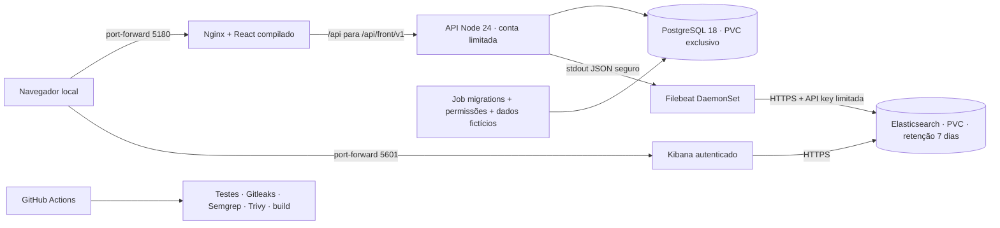

# Demonstração DevOps local — RepHouse 4.2.0

Este ambiente é separado do Compose usado pela equipe. Não lê o `.env` principal, não utiliza `rabbu_mvp`, não publica imagens e não configura acesso pela internet.

## Arquitetura



Namespaces: `rephouse-demo` e `rephouse-observabilidade`. A aplicação usa Deployments; o banco e o Elasticsearch usam StatefulSets. Secrets são injetados na execução, não nos bundles do frontend.

## Preparação

Use Node 24 e Docker Desktop em containers Linux. Ative Kubernetes, mantenha um único nó e confira:

```powershell
docker info
kubectl --context docker-desktop get nodes
node infra/devops/operar.mjs preparar
```

O controlador recusa contextos remotos, mais de um nó e namespaces existentes sem a identificação desta demonstração. `preparar` gera credenciais exclusivas em `.devops-local/devops/credenciais.json`, ignorado pelo Git. Não envie esse arquivo, certificados privados ou manifests contendo Secrets para colegas, relatórios ou capturas.

São usados aproximadamente 8 GiB disponíveis no Docker. As cargas têm requests/limits; builds e testes devem terminar antes da apresentação. Não aumente réplicas nem execute carga enquanto toda a observabilidade estiver ligada.

Secrets Kubernetes não são um cofre: base64 não é criptografia. Nesta etapa eles ficam no cluster local, com os valores fora do Git e sem annotations contendo uma cópia adicional. Cofre externo e criptografia de armazenamento do cluster precisam ser definidos antes de publicação pública.

## Construção e implantação

Na raiz do repositório:

```powershell
node infra/devops/operar.mjs build
node infra/devops/operar.mjs implantar
node infra/devops/operar.mjs status
node infra/devops/operar.mjs acessar
```

O último comando permanece aberto. Ctrl+C fecha os port-forwards, sem apagar a aplicação ou seus dados.

- RepHouse: **http://localhost:5180/login**
- Kibana: **http://localhost:5601**
- Dashboard: **RepHouse — operação local**

As portas 5173/3000/5432 do ambiente habitual não são alteradas. PostgreSQL e Elasticsearch não recebem NodePort, LoadBalancer ou exposição pública.

O Job aplica as migrations reais, provisiona uma conta limitada e semeia dados fictícios de duas casas. A credencial administrativa não entra no Pod da API. Repetir a preparação preserva os dados e senhas existentes. Não há reset automático.

Contas fictícias: `admin.aurora@demo.rephouse.test`, `ana@demo.rephouse.test`, `admin.horizonte@demo.rephouse.test`, `bruno@demo.rephouse.test`, `carla@demo.rephouse.test` e `master@demo.rephouse.test`. A senha é o campo `demoPassword` do arquivo local. No Kibana, use `demo_observer` e `observerPassword`. Não exiba o arquivo inteiro durante a apresentação.

Google e Resend não estão configurados nesse banco. Login por senha continua disponível. A demonstração não envia e-mails reais nem usa credenciais do ambiente da equipe.

## Observabilidade e segurança

- Elasticsearch, Kibana e Filebeat: **9.5.6**, licença Basic.
- Elasticsearch usa HTTPS com certificado local de 90 dias; clientes validam o certificado. Nenhum `verification_mode: none` ou desativação de TLS.
- Filebeat usa entrada filestream/container/JSON, API key exclusiva e índices `rephouse-api-*`. Não lê Docker socket, corpos HTTP ou arquivos da aplicação.
- O coletor roda como UID 0 para ler os logs do nó, sem modo privilegiado, sem capabilities, sem elevação e com filesystem raiz somente leitura. Seus mounts de logs são somente leitura; apenas o registro de offsets tem escrita. O namespace de observabilidade admite essa exceção de hostPath; o da aplicação exige Pod Security Restricted.
- As aplicações não recebem tokens de ServiceAccount. Não há RBAC administrativo de coleta.
- Logs mantêm `timestamp`, `event`, `requestId`, `path`, `status`, `durationMs` e acrescentam horário/serviço/versão/nível para ingestão. URLs livres, query strings, e-mails, JWTs e links de confirmação não devem aparecer.
- Índices diários têm retenção de sete dias, um shard e nenhuma réplica, adequados a esta demonstração de um nó. Isso não representa alta disponibilidade.
- O dashboard exclui healthchecks; a duração p95 também exclui conexões SSE de longa duração. 4xx e 5xx são indicadores diferentes; p95 em amostra pequena não comprova SLO.

Em Discover, selecione `rephouse-api-*` e pesquise, por exemplo:

```text
event: http AND status >= 400
requestId: "identificador-retornado-pela-api"
```

## Pipeline e verificações locais

```powershell
npm run test:completo
npm --prefix interface run verificar
node infra/devops/seguranca.mjs
node infra/devops/validar-imagens.mjs
node infra/devops/validar.mjs --operacao
node infra/devops/validar-observabilidade.mjs
```

Os dois primeiros comandos usam exclusivamente o banco dedicado aos testes. O terceiro requer imagens construídas e Docker ativo. Gitleaks examina histórico e arquivos candidatos ao Git com resultados redigidos. Semgrep usa regras locais versionadas; Trivy examina dependências e imagens exportadas, sem Docker socket. Relatórios ficam em `.devops-local/devops/seguranca/`.

Os ensaios `validar` precisam de `acessar` aberto. Criam registros fictícios no banco da demonstração e `--operacao` recria seu Pod do PostgreSQL e testa atualização/rollback usando uma tag de ensaio do mesmo conteúdo da imagem. Não representam publicação de uma nova versão funcional nem alteram migrations. Execute os ensaios de aplicação e observabilidade sequencialmente. Depois de substituir o Pod do frontend, reabra `acessar`, pois port-forward termina com o Pod antigo.

Ferramentas fixadas: Gitleaks 8.30.1, Semgrep 1.185.0 e Trivy 0.76.2. As regras SAST são uma camada mínima para execução de código, shell, SQL inseguro e TLS; não equivalem a uma auditoria completa nem comprovam ausência de vulnerabilidades. Segredos fictícios de testes podem gerar achados e exigem revisão individual. Não crie uma exclusão geral para obter aprovação.

O workflow mantém backend/contrato e acrescenta frontend, scanners e builds, nos eventos existentes e em `teste-devops`. Não faz deploy nem push de imagens. Relatórios são preservados mesmo se o job falhar. Uma suíte com falhas preexistentes continua reprovada.

## Operação e apresentação

1. Conferir Pods, Services e PVCs com `status`.
2. Abrir a aplicação compilada e entrar na casa Aurora.
3. Abrir perfil, tarefas e despesas; demonstrar o aviso chegando por SSE entre duas contas fictícias.
4. Localizar no Kibana o `requestId` de uma requisição, mostrar 4xx separado de 5xx e a duração.
5. Demonstrar reinício do Pod do banco mantendo dados e uma atualização/rollback somente da imagem da API. Rollback de imagem não desfaz migrations.
6. Apresentar os relatórios de testes e scanners com falhas e limitações visíveis.

Para parar somente a demonstração, preservando os volumes:

```powershell
node infra/devops/operar.mjs parar
```

Para voltar, execute `implantar` e `acessar`. Nunca use `docker system prune --volumes`, reset do cluster ou exclusão dos namespaces como rotina de parada. PVCs locais não substituem backup; reset/recriação do cluster pode perder o armazenamento local.

A fase atual não inclui publicação na internet, registro remoto de imagens, APM, Helm, GitOps, testes de carga ou autoscaling. Acesso pelo celular e links mágicos públicos exigem uma etapa posterior com origem acessível e HTTPS.
